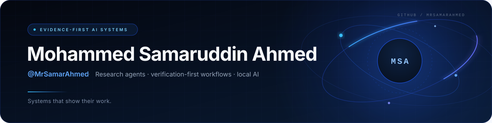

  <picture>
    <source media="(max-width: 600px)" srcset="./assets/banner-mobile.svg">
    
  </picture>

  

  
  
  

## Systems that show their work

I'm Mohammed Samaruddin Ahmed, a Mechanical Engineering undergrad who builds AI systems that have to prove themselves: research agents with inspectable sources, debugging workflows that stop for human approval, and reliability tooling whose success is decided by a verifier rather than a confident sentence.

Most of my projects share one shape: **a probabilistic model can propose, but deterministic code decides what counts as done.**

- **Evidence over assertion.** Citations are checked against retrieved sources; fixes are recorded against real test runs.
- **Verification before resolution.** A recovery or a fix is not finished until a separate verifier confirms it.
- **Honest failure.** Missing credentials, unproven fixes, and unavailable providers are reported, not papered over.

**Currently**

- 🌱 Learning **Go** from the ground up — fundamentals first, no proficiency claims yet.
- ☁️ Reading cloud-native codebases (starting with **Meshery**) to prepare for open-source contribution.
- 🎯 Working toward **GSoC 2027**, with LFX Mentorship 2027 as a parallel track.

## Selected work

### 01 · ORBIT Machine Guardian

*Autonomous reliability for rotating machinery, in simulation. Built for the AMD Developer Hackathon ACT III.*

A closed-loop agent for a simulated 6205-bearing motor rig: it reads vibration and temperature windows, detects faults, ranks competing hypotheses, plans a precondition-checked intervention, and verifies recovery before closing an incident. Only a deterministic verifier can mark an incident resolved; when recovery cannot be proven, the incident escalates instead.

> **Simulation boundary:** every machine scenario is simulated. ORBIT does not connect to or control real industrial equipment, and the project does not claim AMD GPU or ROCm execution.

**Stack** — Python · FastAPI · Streamlit · PyTorch · NumPy · SciPy · AMD Token Factory

**[View the repository →](https://github.com/MrSamarAhmed/ORBIT-MACHINE-GUARDIAN)**

### 02 · ORBIT Search

*A research workflow that leaves the queries, sources, and citations visible behind the answer.*

It plans several sub-queries, searches the live web through SerpApi, deduplicates the results, and asks Gemini to write an answer from the collected evidence only. When synthesis is rate-limited or unavailable, it returns the sources and a warning instead of inventing an answer; answer URLs that were not in the evidence are flagged. The API exposes each stage's output, and the browser workspace ships with no build step.

**Stack** — Python · FastAPI · SerpApi · Google Gemini · httpx · Vanilla JS · Docker

**[View the repository →](https://github.com/MrSamarAhmed/ORBIT-SEARCH)**

### 03 · MaintAI

*From failure to verified fix, with a human approval gate. Built for the IBM Bob 2.0 Hackathon.*

It drives IBM Bob 2.0 through an investigation protocol: provenance-bearing evidence, competing hypotheses, an adversarial review, and an exact patch proposal. A human decision is bound to the run and file digests; the patch is applied only after approval, and verification is a real `unittest` run executed by the trusted workflow. If Bob is unavailable, the run fails closed.

> **Scope note:** a local demonstration control plane for a deterministic concurrent-inventory bug, not a production security boundary. The README lists its open limitations.

**Stack** — Python · FastAPI · IBM Bob 2.0 · Next.js · React · TypeScript · Tailwind CSS

**[View the repository →](https://github.com/MrSamarAhmed/MaintAI)**

### 04 · Tablekeeper

*Stage 1 of the WeAreDevelopers × BAND Dark Factory — a service built by an agent factory.*

A FastAPI + SQLite table-reservation service produced by a three-agent Architect → Builder → Reviewer pipeline with rejection, revision, and approval cycles. The repository preserves the factory's BAND transcript, build attempts, review records, and the Stage 1 artifact, alongside its Docker setup and contract tests.

> **Scope note:** a Stage 1 hackathon submission. The README documents an unresolved specification conflict and open limitations.

**Stack** — Python · FastAPI · SQLite · Docker · BAND · GitHub Actions

**[View the repository →](https://github.com/MrSamarAhmed/dark-factory-tablekeeper)**

## More work

- **[Second-Opinion](https://github.com/MrSamarAhmed/Second-Opinion)** — Audits Qloo music recommendations for supporting metadata, with re-derivable receipts and a bounded follow-up lookup. Standard-library Python.
- **[ShipProof](https://github.com/MrSamarAhmed/shipproof)** — A browser-only ledger that audits completion claims against linked JUnit evidence, even when every test in the report passes. TypeScript · Vite · Vitest.
- **[StandIn](https://github.com/MrSamarAhmed/standin)** — Local-first, reversible pseudonymization for using AI on confidential documents, running entirely in the browser. React · TypeScript · Transformers.js · ONNX.

## Toolkit

  <a href="https://github.com/MrSamarAhmed?tab=repositories">
     
    
  </a>

**Languages** — Python · TypeScript · SQL · JavaScript 
**Backend & services** — FastAPI · Uvicorn · Streamlit · SQLite · Docker · httpx 
**AI & agents** — Google Gemini · SerpApi · IBM Bob 2.0 · BAND · Qloo · AMD Token Factory · Transformers.js 
**Data & ML** — PyTorch · NumPy · SciPy · ONNX 
**Frontend** — React · Next.js · Tailwind CSS · Vite 
**Testing & delivery** — pytest · Vitest · unittest · GitHub Actions · pnpm

Only tools that appear in the repositories above are listed; this is not a proficiency ranking. Go is deliberately absent — it is in progress, not yet evidenced.

## GitHub analytics

  
  

  

  

Every project links to its public repository. Claims are limited to what each repository's README and source code support. ORBIT Machine Guardian operates on simulated machine scenarios only.